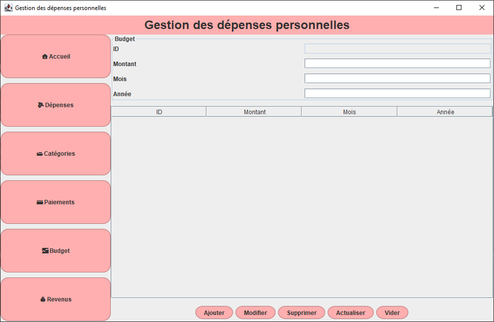
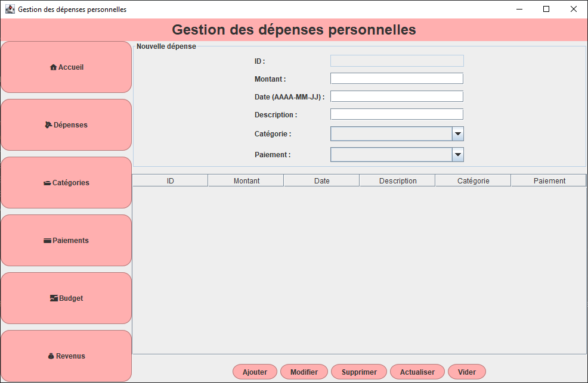
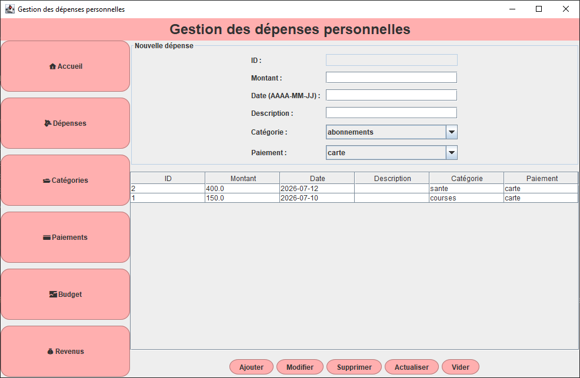
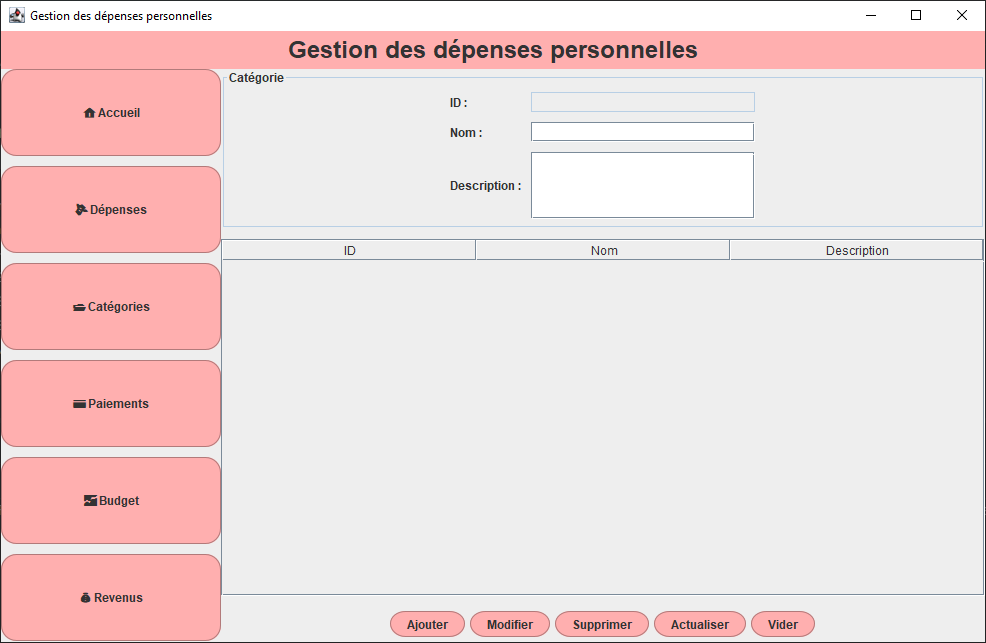
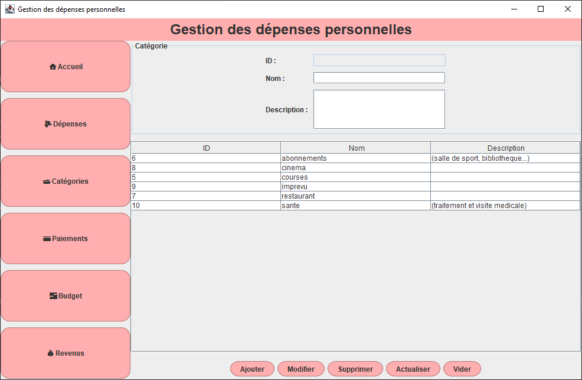
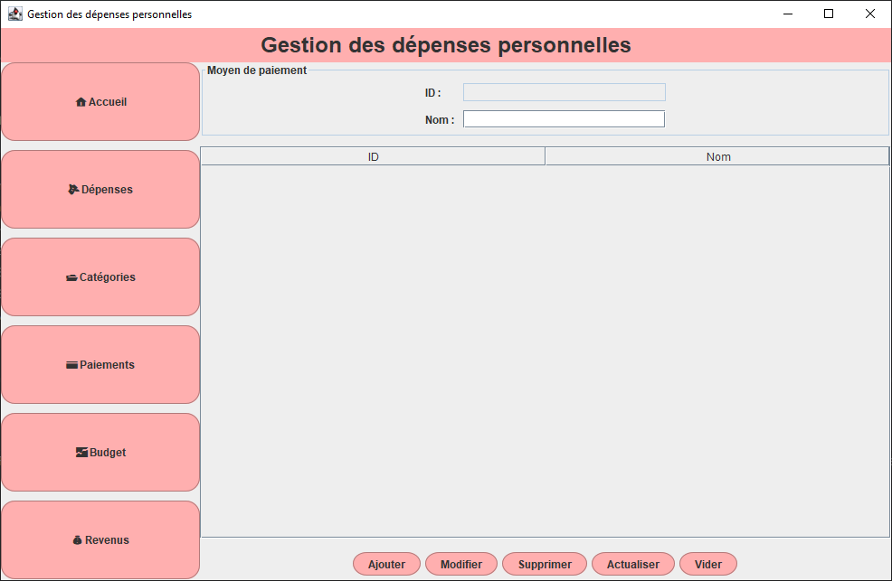
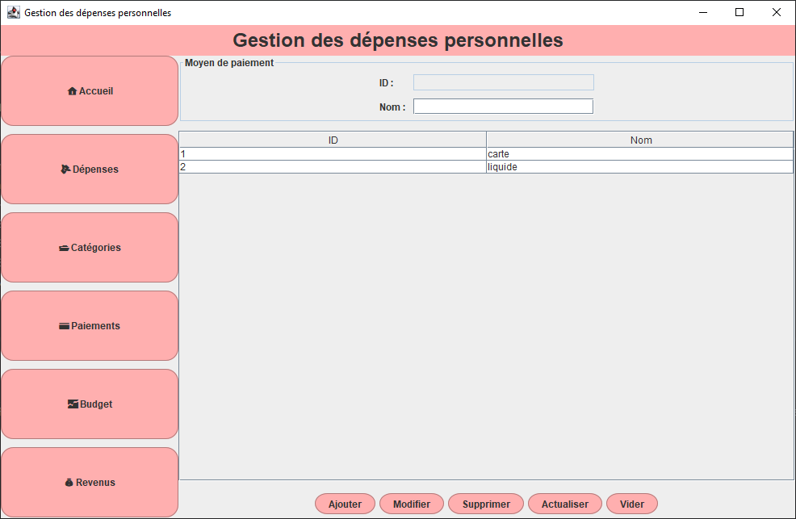
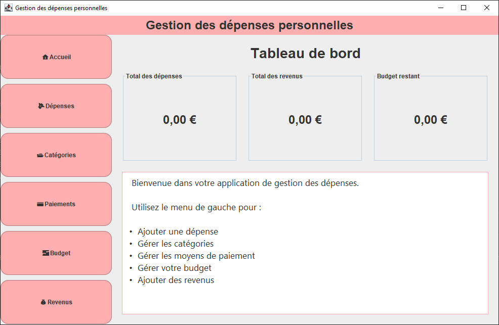
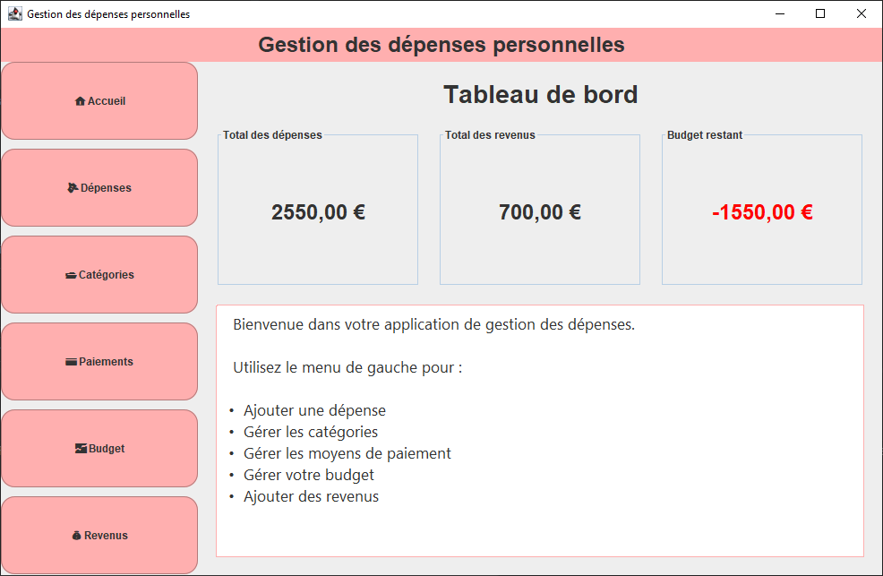

# Budget Manager (SQLite)

A desktop application developed with **Java Swing** that allows users to manage a personal budget and track expenses through an intuitive graphical interface. All data is stored in an embedded **SQLite** database, making the application **portable** and eliminating the need for installing or configuring a database server.

---

# Features

* Create and edit a budget.
* Add new expenses.
* Edit existing expenses.
* Delete expenses.
* Organize expenses by category.
* Manage payment methods.
* Record income.
* Display expense statistics.
* Automatically calculate the remaining budget.
* Display a warning when the budget becomes negative.
* Automatically save all data in an SQLite database.

---

# Technologies Used

* Java 17
* Java Swing
* JDBC
* SQLite
* IntelliJ IDEA

---

# Database

The application uses an **SQLite** database (`gestion_depenses.db`) containing the following tables:

* `budget`
* `depense`
* `categorie`
* `moyen_paiement`
* `revenu`

The database is embedded with the application, allowing it to run without any additional database configuration.

---

## Dashboard and Statistics

*Main dashboard displaying expense statistics and budget usage.*

---

## Budget Management

*Displays the current budget and the remaining available amount.*

---

## Expense Management

*Form for adding new expenses and table displaying all recorded expenses.*

---

## Category Management

*Interface for creating and managing expense categories.*

---

## Payment Method Management

*Interface for managing different payment methods.*

---

## Empty Database

*Application state when no expenses have been recorded yet.*

---

## Negative Budget Warning

*Example of the warning displayed when expenses exceed the available budget.*

---

# Advantages of the SQLite Version

* No MySQL installation required.
* No database server configuration.
* Embedded local database.
* Easily portable between computers.
* Simplified deployment and setup.

---

# Future Improvements

* Filter expenses by month.
* Search expenses.
* Export data to PDF or Excel.
* User authentication.
* Dark mode.

---

# Installation

## From Source

1. Clone the repository.
2. Open the project in IntelliJ IDEA.
3. Make sure the SQLite JDBC driver is included.
4. Run the application.

## Portable Version

1. Download the latest release from the **Releases** section.
2. Extract the ZIP archive.
3. Launch the `.exe` or `.jar` file.
4. The SQLite database is automatically created if necessary, and all data is stored locally.

---

# Author

Developed by **DJOUBER Dina** to strengthen skills in Java programming, object-oriented programming, Swing GUI development, JDBC, and SQLite database management.
