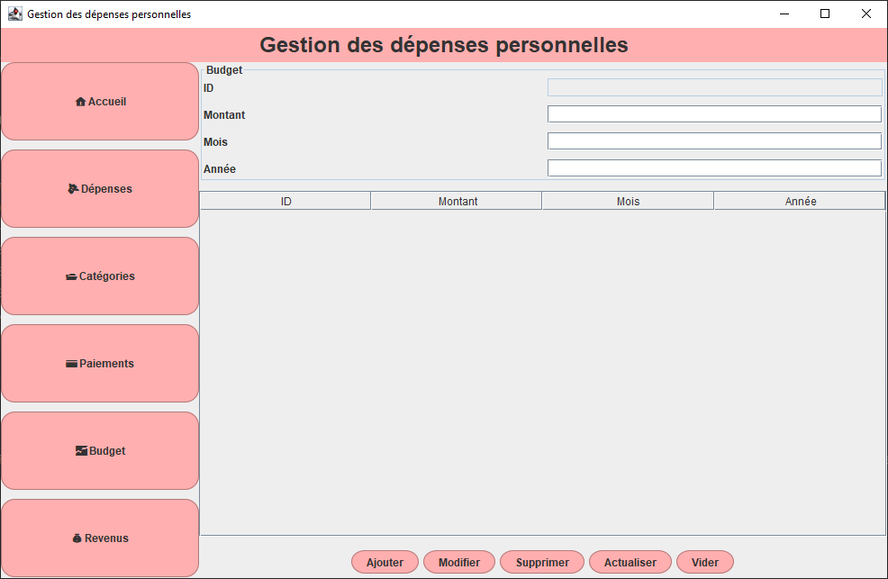
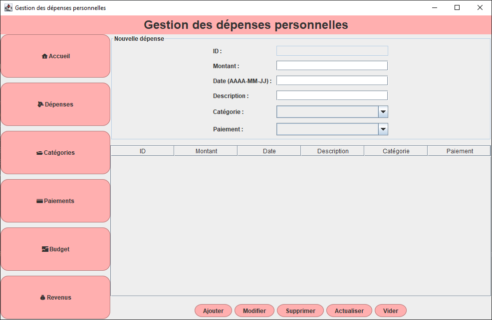
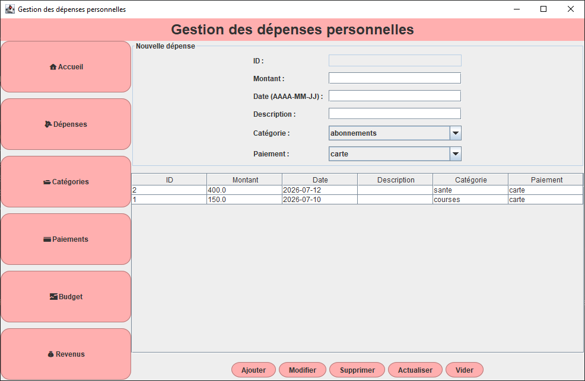
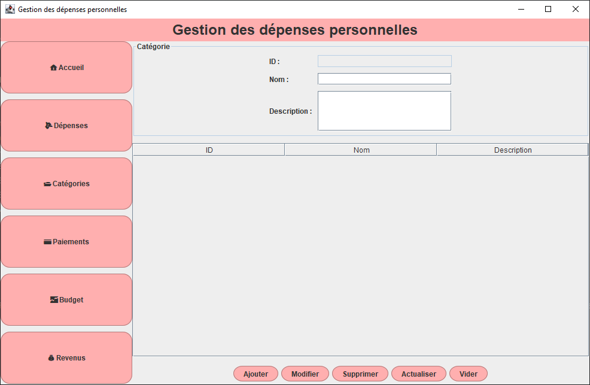
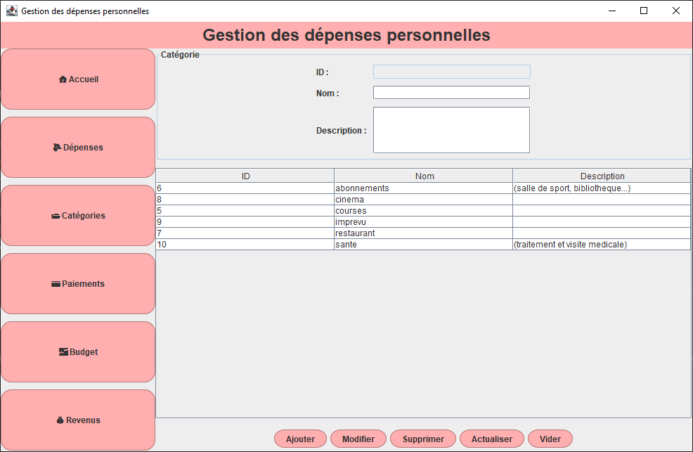
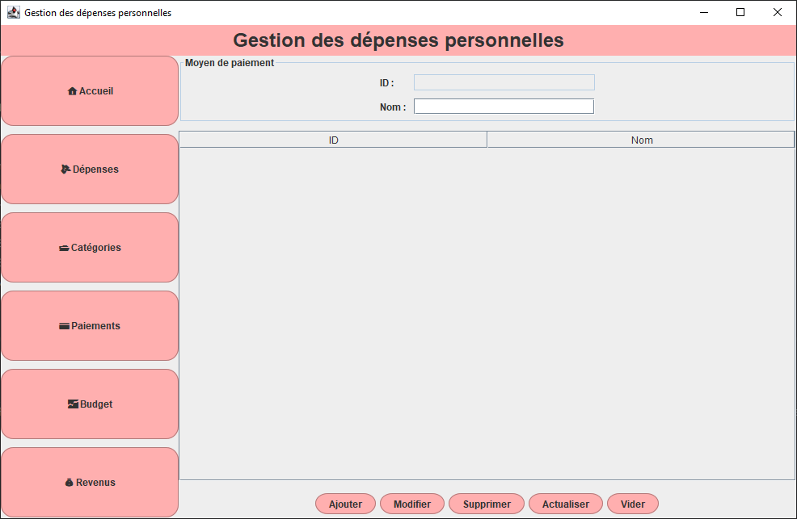
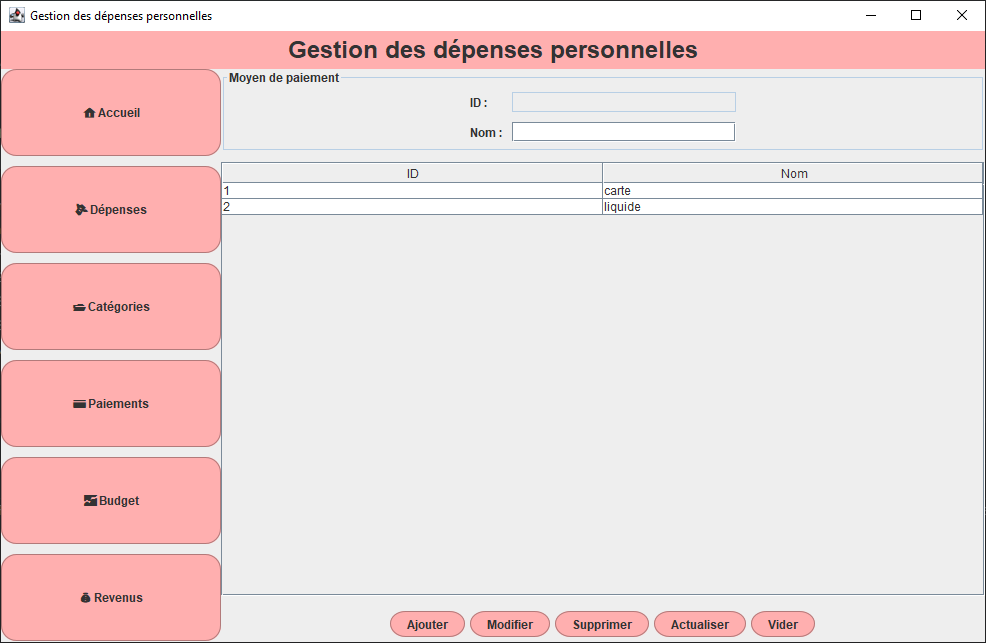
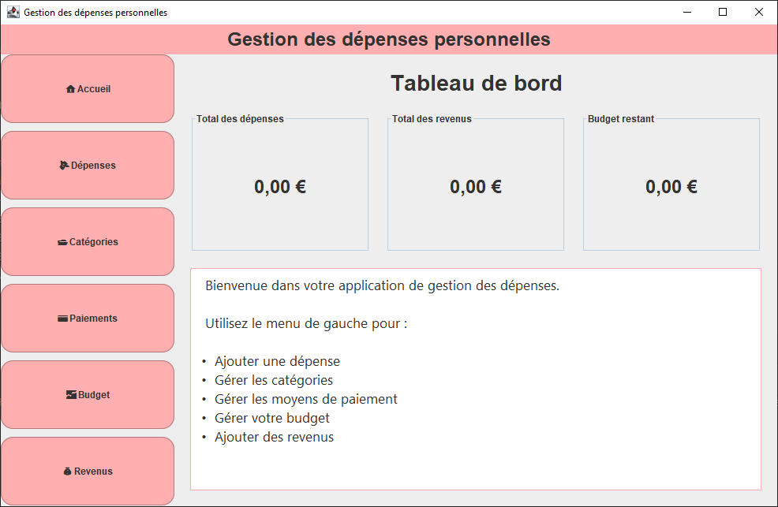
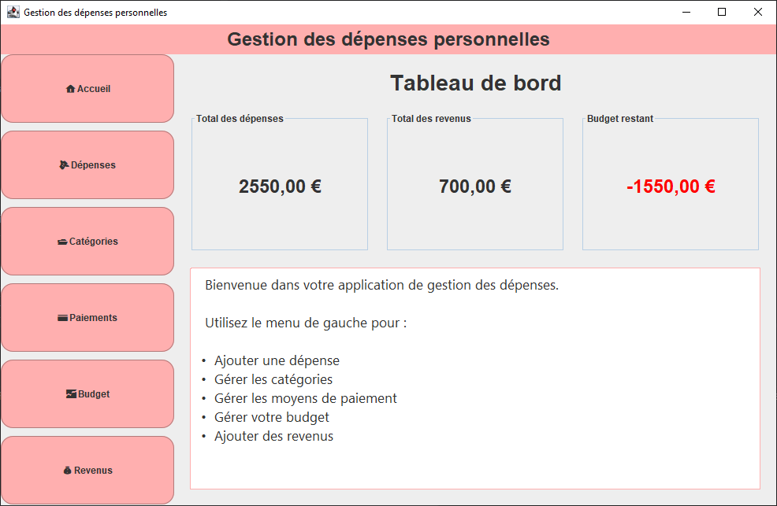

# Gestionnaire de Budget (SQLite)

Une application de bureau développée en **Java Swing** permettant de gérer un budget personnel et de suivre ses dépenses grâce à une interface graphique intuitive. Toutes les données sont enregistrées dans une base de données **SQLite** incluse avec l'application, ce qui la rend **portable** et ne nécessite aucune installation d'un serveur de base de données.

---

# Fonctionnalités

* Créer et modifier un budget.
* Ajouter une nouvelle dépense.
* Modifier une dépense existante.
* Supprimer une dépense.
* Organiser les dépenses par catégorie.
* Gérer les moyens de paiement.
* Enregistrer des revenus.
* Afficher des statistiques sur les dépenses.
* Calculer automatiquement le budget restant.
* Afficher une alerte lorsque le budget devient négatif.
* Enregistrer automatiquement toutes les données dans une base de données SQLite.

---

# Technologies utilisées

* Java 17
* Java Swing
* JDBC
* SQLite
* IntelliJ IDEA

---

# Base de données

L'application utilise une base de données **SQLite** (`gestion_depenses.db`) composée des tables suivantes :

* `budget`
* `depense`
* `categorie`
* `moyen_paiement`
* `revenu`

La base de données est directement intégrée au projet, ce qui permet d'utiliser l'application sans configuration supplémentaire.

---

## Tableau de bord et statistiques

*Interface principale avec visualisation des dépenses et de l'utilisation du budget.*

---

## Gestion du budget

*Affichage du budget actuel et du montant restant.*

---

## Liste des dépenses

*Formulaire permettant d'ajouter une nouvelle dépense et tableau affichant toutes les dépenses enregistrées.*

---

## Gestion des catégories

*Interface permettant d'ajouter et de gérer les catégories de dépenses.*

---

## Gestion des moyens de paiement

*Interface permettant de gérer les différents moyens de paiement.*

---

## Base de données vide

*État de l'application lorsqu'aucune dépense n'a encore été enregistrée.*

---

## Budget négatif

*Exemple de l'alerte affichée lorsque les dépenses dépassent le budget disponible.*

---

# Avantages de la version SQLite

* Aucune installation de MySQL.
* Aucune configuration de serveur.
* Base de données intégrée à l'application.
* Application facilement transportable d'un ordinateur à un autre.
* Déploiement simplifié.

---

# Améliorations futures

* Filtrage des dépenses par mois.
* Recherche de dépenses.
* Export des données (PDF/Excel).
* Authentification des utilisateurs.
* Mode sombre.

---

# Installation

## Depuis les sources

1. Cloner le dépôt.
2. Ouvrir le projet avec IntelliJ IDEA.
3. Vérifier que le pilote JDBC SQLite est présent dans le projet.
4. Lancer l'application.

## Version portable

1. Télécharger la dernière version dans **Releases**.
2. Extraire l'archive ZIP.
3. Lancer l'exécutable (`.exe`) ou le fichier `.jar`.
4. La base de données SQLite est créée automatiquement si nécessaire et les données sont enregistrées localement.

---

# Auteur

Développé par **DJOUBER Dina** dans le cadre d'un projet universitaire afin de mettre en pratique la programmation Java, la programmation orientée objet, le développement d'interfaces graphiques avec Swing, JDBC et l'utilisation de bases de données SQLite.
